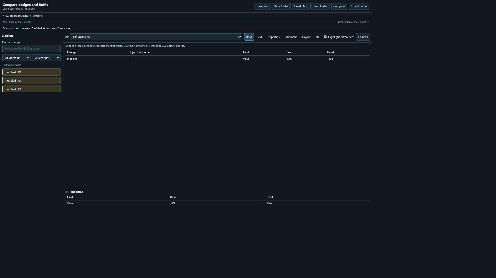
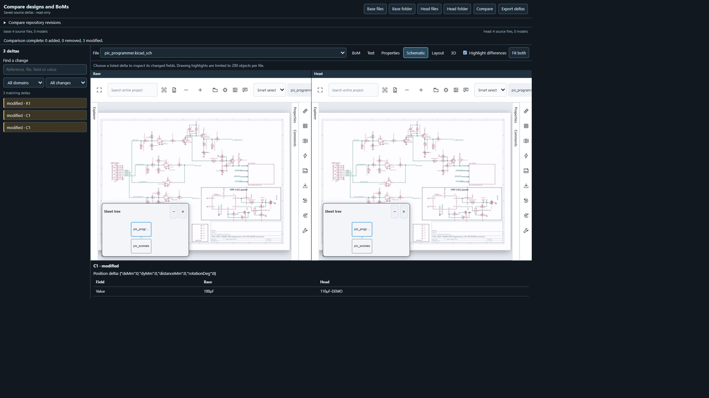
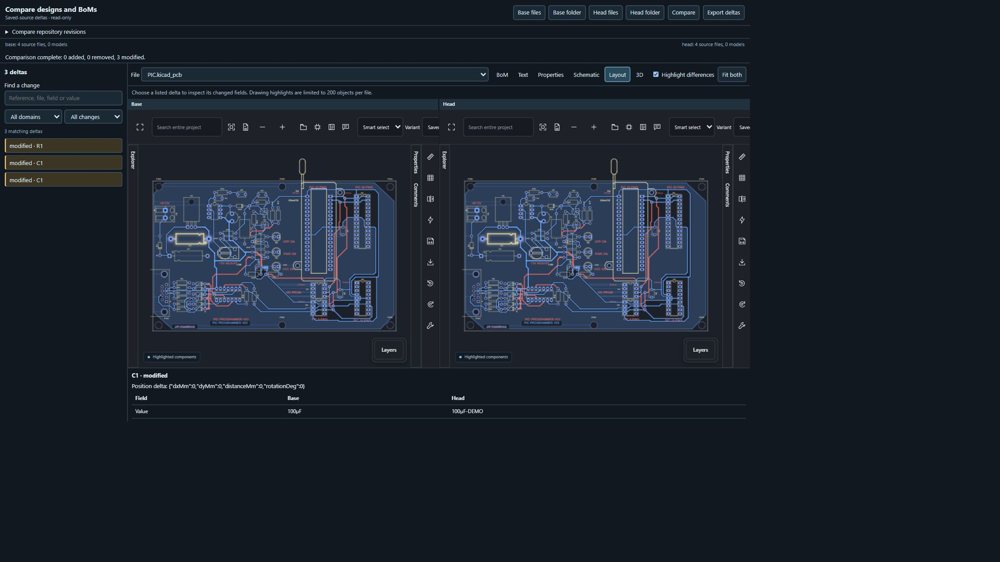
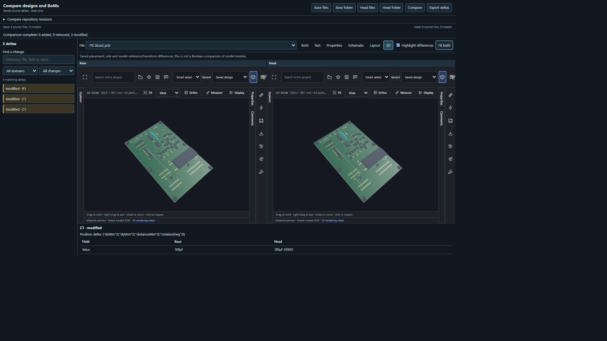
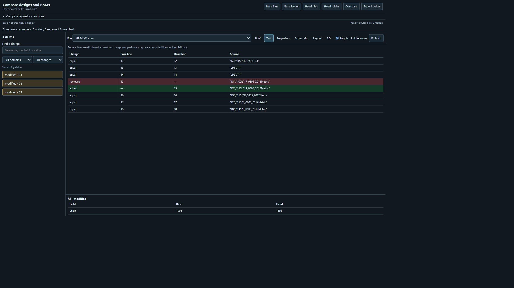
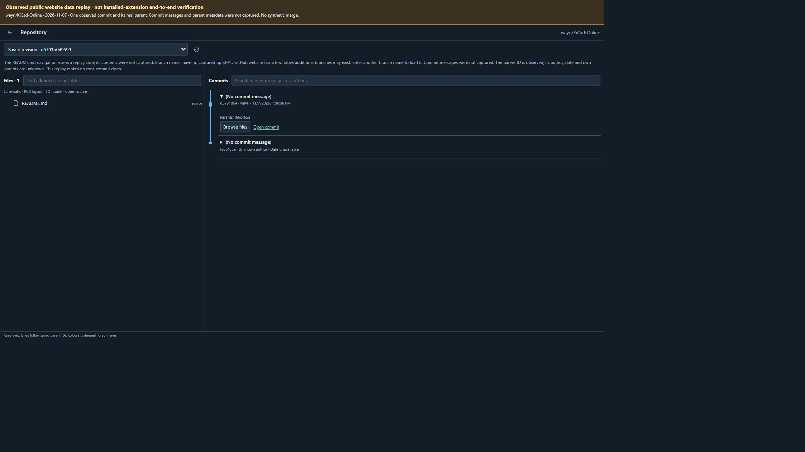

# Compare designs and BoMs

Available in the **0.12.91 local release candidate**. Published store versions may differ.

Open **Engineering tools → Compare designs / CSV BoMs**, **Compare BoMs** in the BoM viewer, or **Unified compare** in a repository drawing review.

1. Import the base and head files, or import both project folders. Folder imports preserve paths, subsheets and included model files.
2. Choose **Compare**. The list reports added, removed and modified objects; use the search and domain/status filters to narrow it.
3. Select a delta, then choose **BoM**, **Text**, **Properties**, **Schematic**, **Layout** or **3D**. Select another file to inspect its domain.
4. Use **Highlight differences** and **Fit both** for the drawing panes. Each pane retains its own navigation.
5. Choose **Export deltas** to download the comparison report. Source files remain unchanged.

CSV BoMs are matched by expanded component references, so reordered rows and grouped references do not create false changes. Value, footprint, custom fields and population changes appear as before/after values. Ambiguous or duplicate references are rejected.

For repository revisions, open this tool from the authorized repository viewer, enter the base and head references and choose a saved drawing or source file. Reads use the existing browser-session transport. Organization SSO and website policies continue to apply.

## What a delta means

Schematic and PCB identities are scoped to their source file. Property, position and rotation changes are reported from saved objects. The 3D tab uses the production PCB viewer to highlight those objects; model-reference and saved transform changes are listed. It does **not** compute Boolean differences between component meshes. Missing model files retain the viewer's normal diagnostics. Repository comparison currently imports drawing sources without STEP/WRL assets; import complete local folders to include model geometry.

Imports accept up to 128 files and 96 MiB per revision. Drawing highlighting shows at most 200 changed objects per file. Text comparisons use bounded work and disclose fallback or rendering limits. A change count describes the saved objects supported by the parser, not an electrical-equivalence check or a pixel-perfect visual diff.

## Repository branches and history

Open **Repository** to browse files, select a branch and inspect the commit graph. Graph lines follow verified parent IDs; missing ancestry is labelled unknown. Browser-session discovery reads a bounded website window: up to 20 branch entries and the initial 30 commits. Partial listings are identified explicitly. No branch tip or parent is inferred from ordering.

## Fresh comparison examples

These captures use retained public demo files with **controlled, labelled edits**, rather than claiming two upstream releases differ. The PIC Programmer example changes C1's value; the HP34401a BoM example changes R1 from 100k to 110k. The board remains the original public design. Demo authors and sources are listed in [acknowledgements](DEMO-BOARD-CREDITS.md).

The graph capture below is explicitly a **replay of observed public website metadata**, using the production graph UI. It is not an installed-extension end-to-end test. It shows the verified parent of commit `d5791b0` in `wayri/KiCad-Online`; uncaptured parent metadata remains unknown.

