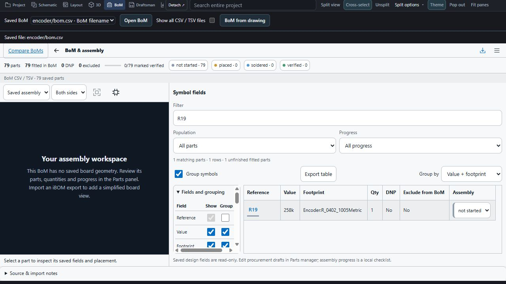
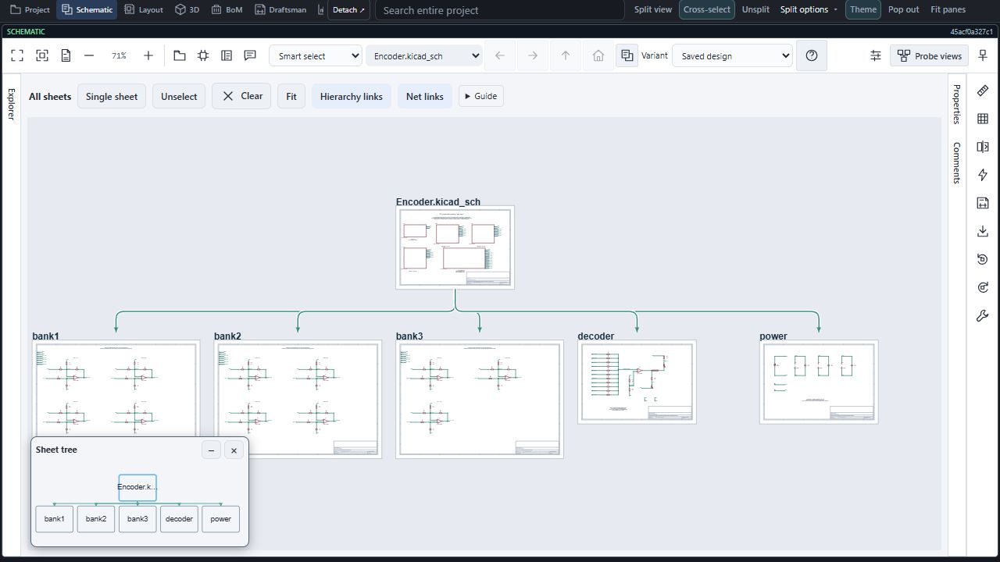

# BoM, sheet routing and comment loading verification

Recorded 9 November 2026 using the development viewer. The Codex in-app browser loaded the saved public KERO encoder design at revision 45acf0a327c1f387e9fb1024638c3fbd06870ddc through a local transport.

The BoM tab offered root and encoder-directory CSV files without silently choosing between them. Opening encoder/bom.csv loaded 79 saved parts; filtering R19 showed its 258k resistor entry. Back returned to the existing drawing, the filter survived switching tabs, and BoM from drawing opened the native 79-part table.

The six-sheet overview showed a shared hierarchy rail, distinct child arrows and the fitted miniature tree. Net guides remain visually distinct from hierarchy paths.

Comment tests cover public website readback without login metadata, ordinary issue bodies/replies without location metadata, independent catalog/marker refresh, visible errors and retained backoff. The local gallery intentionally disables remote review access. These captures are not live installed-extension evidence that KERO issue sync works; that specific check remains outstanding. No private design data was used.

Focused verification at capture time: 440 JavaScript tests passed across viewer, transport, import, hierarchy and comment suites; two Python asset checks and whitespace checks passed. Later standalone BoM source-navigation checks passed separately. The final release gate is reported in the release notes; these scoped checks do not replace it.

Board source and attribution: [wayri/KERO encoder](https://github.com/wayri/KERO/tree/45acf0a327c1f387e9fb1024638c3fbd06870ddc/encoder). KERO is an experimental AI-generated hardware-design evaluation, not bench-qualified hardware.
