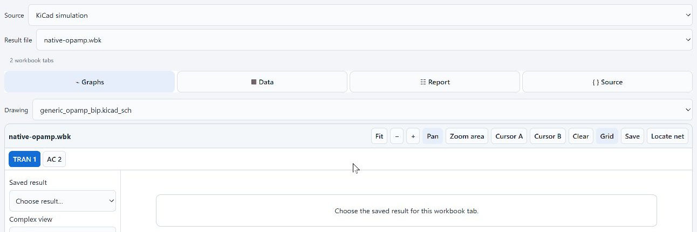
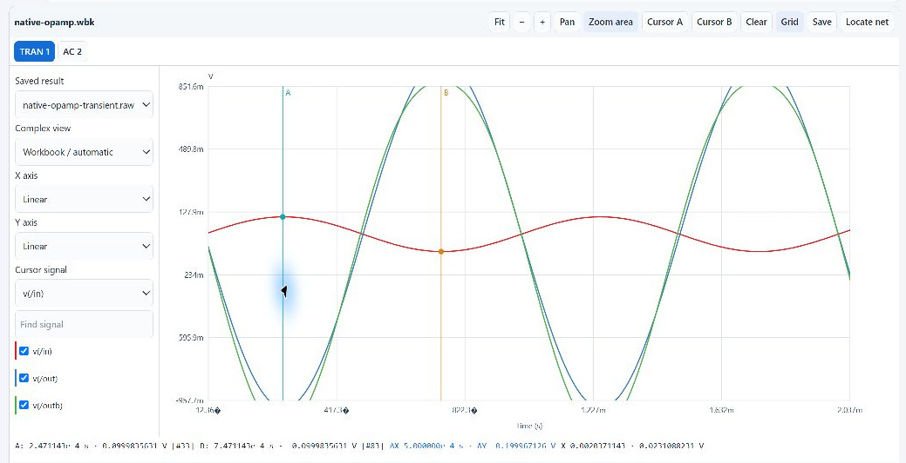
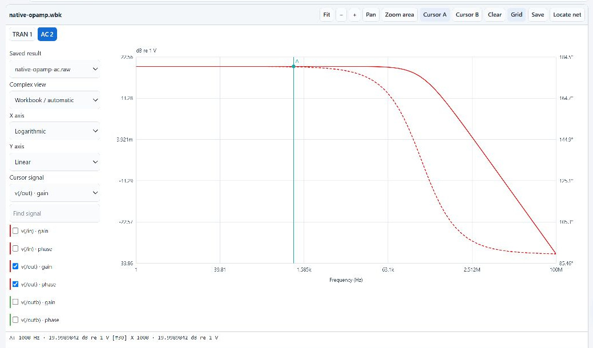
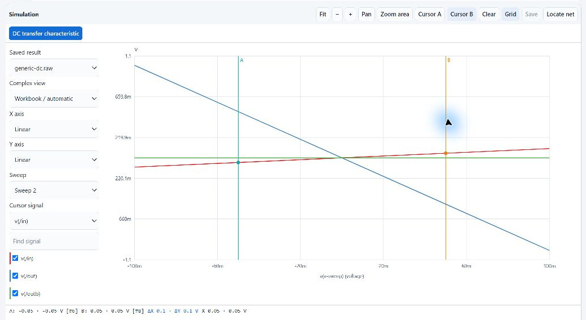
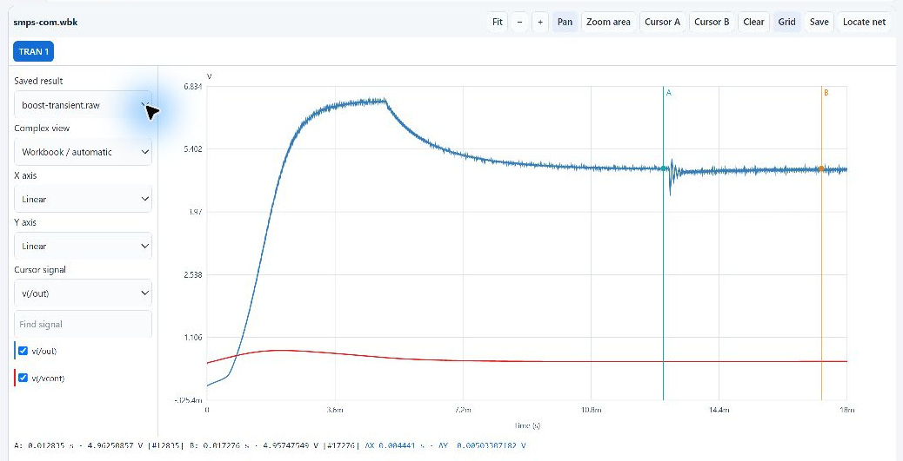
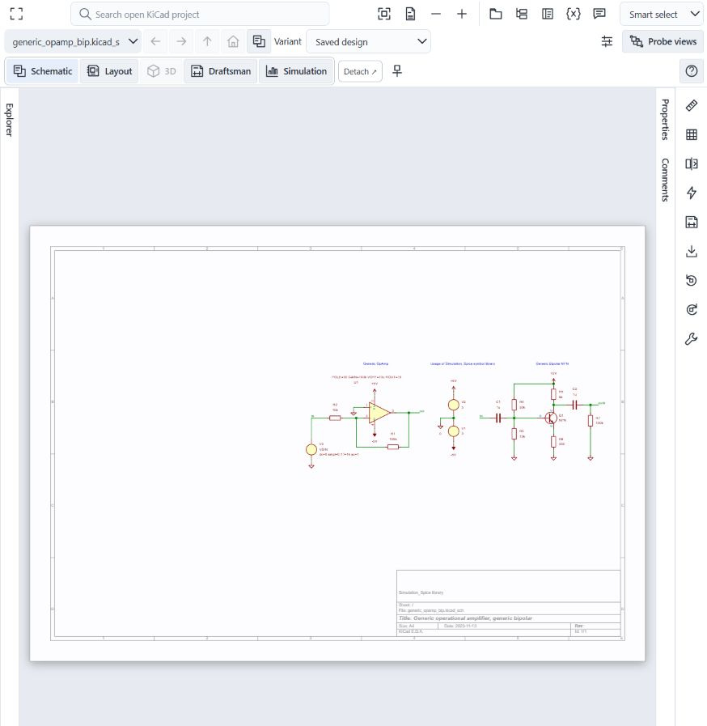

# Review KiCad workbooks and drawing sheets

Run the simulation in KiCad, then review its saved waveforms in KiCad Online. Use the workbook to retain the analysis tabs, trace names, display settings, and saved cursor positions. Keep the waveform exports alongside it.

## 1. Save and open a workbook

1. In KiCad Schematic Editor, choose **Inspect → Simulator**. Open or create an analysis tab and run it.
2. In the simulator, select the signals you want to share. Choose **File → Save Workbook** to save the **.wbk** file. On each plot tab, choose **File → Export Current Plot as CSV**. Give each result a distinct name. KiCad Online also reads supported ngspice ASCII **.raw** and TSV files.
3. Add the workbook and exports to the same repository revision or imported project folder. From the project bar, open **Simulation** and choose **KiCad internal**. If there is one matching workbook, it opens directly. If there are several, search for the one you want and open it from the list or cards. **WayriCAD** shows saved WayriCAD exports, and **Other exports** shows files without a recognized source.
4. Choose an analysis tab. Under **Saved result**, choose the export from that run. Repeat for each tab. A workbook without an attached result shows the saved setup. You can also open an ASCII RAW result directly.

The workbench inherits the drawing workspace's light or dark theme. Use **Browse results** to switch files, and **Axes and display** for scale, sweep, and complex trace controls.

Use **+ Plot row** to stack charts in the active workbook tab. Drag a trace from **Traces** or a colored legend onto another row. You can also select a trace and use **Move here** on the destination. Plot rows share the horizontal axis and scale their vertical axes independently. The viewer saves each tab’s rows, trace assignments, waveform binding, and cursors in this browser profile. Reopen the same workbook at the same project revision to restore them.

The KiCad workbook stores the setup. The CSV or ASCII RAW holds the samples. Export numerical data for interactive review. [KiCad 10 simulator guide](https://docs.kicad.org/10.0/en/eeschema/eeschema.html#saving-simulation-setups)

## 2. Plot and inspect saved samples

| Task | Control |
| --- | --- |
| Choose traces | Use the checkboxes beside each signal. **Find signal** filters the list. |
| Explore a range | Use **Pan** and drag, wheel zoom, or **Zoom area** and drag a range. Shift-drag also selects a zoom area. **Fit** or **Home** restores the full plot. |
| Change axes | Choose linear or logarithmic scaling for X and Y. Use **Grid** to toggle grid lines. |
| Inspect complex AC data | Use **Complex view** to switch between the workbook settings, gain in dB with phase, magnitude with phase, and real with imaginary. Use complex ASCII RAW when you need all these views from one result. |
| Compare nested DC sweeps | Choose **All saved sweeps** or an individual **Sweep**. A repeated X value can have a different result in each sweep. |
| Compare two points | Choose **Cursor signal**, activate **Cursor A**, then click or drag on the plot. Repeat with **Cursor B**. Drag either marker to move it. With the plot focused, the left and right arrow keys move the active cursor by saved samples. |
| Read or reset cursors | Read X, Y, and the sample index under the plot. **ΔX** is B minus A. **ΔY** appears when both cursors use the same trace. **Clear** resets them. |
| Keep a workbook copy | Choose **Save** to download a copy. Keep the waveform exports with it. Read any warnings for settings the workbook format cannot store. |

The transient cursor pair reads 500 µs and −0.199967 V apart. The viewer snaps to saved sample points. Native KiCad remains the place to edit the circuit, tune device values, evaluate simulator measurements, and rerun analyses. [Format and host details](ANALYSIS_VIEWER.md)

### Cross-probe a saved schematic voltage

From the schematic, open **Simulation** and choose **Link net plots** beside a waveform export. Pick a signal to locate its wire, or select a linked net in the schematic to show its waveform. Use **Saved sample** to step through the saved voltage and time. KERO's **ST01_OUT** links on the root, bank 1, and decoder sheets through their exact qualified names. [KERO schematic cross-probe example](https://github.com/wayri/KERO/blob/aab26d9b461297fe7346345e706824c0b0dc6482/encoder/simulation/README.md#probe-the-schematic)

From a waveform plot, select a trace name and choose **Probe drawing** to locate its voltage net. The workbench defaults to the drawing you opened it from when that drawing belongs to the saved project. Select **A** or **B** to place a cursor at a saved sample. In **Pan** mode, drag either cursor line to move it along its own trace. Hover to inspect a sample without moving the cursors.

## 3. Try the example circuits

| Circuit | Saved results to review | What to look for |
| --- | --- | --- |
| KERO encoder | Six switching transients | Follow the eleven-stage ring, decoder margin, frame timing and coin-cell current. The six cases reproduced the original waveform hashes and all ten complete frames decoded hello world. [KERO encoder workbook and plots](https://github.com/wayri/KERO/blob/aab26d9b461297fe7346345e706824c0b0dc6482/encoder/simulation/README.md) |
| KERO R1/C3 timing branch | Transient and AC | The isolated 1 MΩ/1 µF branch has a 1 s time constant. The AC output at 0.159 Hz is about −3.01 dBV and −45° with the ideal 1 V test source. |
| KiCad generic op-amp demo | Transient, AC, and a two-source DC sweep | Compare two transient samples, then look for about 20 dBV at 1 kHz in the AC tab. In DC, select a sweep to distinguish two branches that share the same input voltages. |
| KiCad boost converter demo | Switching transient with a load step | The native workbook restores two output markers. In the viewing export they read about 4.963 V and 4.957 V. Zoom around 13 ms to inspect the load change. |

The op-amp, boost and isolated timing-branch runs used KiCad 10.0.6 schematic exports and its bundled ngspice-46 library. The full KERO encoder ran in Xyce 7.8 with the TI family macro. The separate legacy blinker ran with behavioral amplifiers in ngspice. [Full legacy blinker workbook and results](https://github.com/wayri/KERO/blob/aab26d9b461297fe7346345e706824c0b0dc6482/analysis/simulation/README.md) The boost demo used the native PWM model and produced 1,072,433 adaptive samples. The viewing export uses 18,001 points from ngspice's 1 µs linearized output. Use a smaller time window at finer sampling for switch-edge analysis.

The op-amp AC cursor reads 19.999 dB referenced to 1 V at 1 kHz.

The second DC sweep keeps its own sample indices even when its X values also occur in the first sweep.

The boost workbook restores both cursor positions on the saved output trace.

The isolated KERO example uses its saved R1/C3 timing branch with an ideal test source. The remaining devices are outside this simulation. The op-amp and boost workbooks are from the KiCad demo distribution, licensed CC BY-SA 4.0. The nested DC analysis was added for this walkthrough. [KERO source](https://github.com/wayri/KERO/tree/7be8fef589bc28eee149323e3790ef95b0873032) · [KiCad demo sources](https://gitlab.com/kicad/code/kicad/-/tree/10.0.6/demos/simulation) · [Fixture and numerical references](../extension/tests/fixtures/simulation/native/README.md)

## 4. View a drawing worksheet

Open a schematic or board and use **Sheet** or **Home** to see the paper, border, and title block. **Fit drawing** frames the circuit or board geometry. To preview a different paper format or title block, open **View and page setup → Drawing sheet overrides**, enter the review values, and choose **Apply review page**. **Restore saved page** returns to the source values.

KiCad Online 0.20.0 draws the built-in worksheet. A custom **.kicad_wks** file can be inspected as saved project data. Use native KiCad's Drawing Sheet Editor and Page Setup to apply and render arbitrary custom worksheets. [KiCad 10 Drawing Sheet Editor](https://docs.kicad.org/10.0/en/pl_editor/pl_editor.html)

Workbook screenshots are from Work Chrome using the 0.20.0 viewer with local simulation files. The drawing worksheet capture uses the same viewer in the in-app browser.
